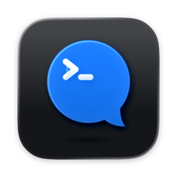
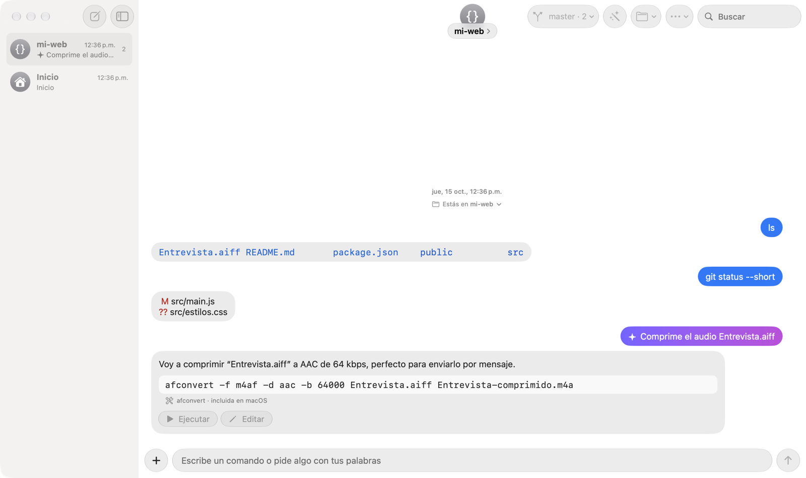
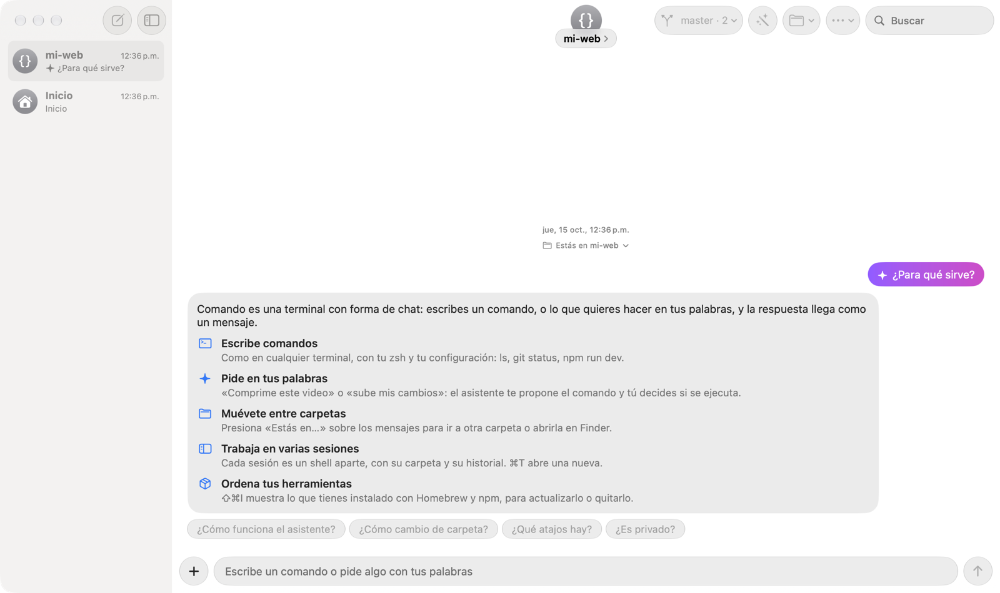

<p align="center">
  
</p>

<h1 align="center">Comando</h1>

<p align="center">
  Una terminal para macOS que funciona como un chat: cada comando es un mensaje y su resultado llega como respuesta.<br>
  Y si no sabes el comando, pídelo con tus palabras.
</p>

<p align="center">
  <a href="https://github.com/maxavend/comando/releases/latest"></a>
  
  
  <a href="LICENSE"></a>
</p>

<p align="center">
  <picture>
    <source media="(prefers-color-scheme: dark)" srcset="docs/images/chat-oscuro.png">
    
  </picture>
</p>

## Requisitos

- macOS 27 o posterior.
- Apple Intelligence activado, para el asistente (opcional).
- Para compilar: Xcode 27 y [XcodeGen](https://github.com/yonaskolb/XcodeGen).

## Instalar

1. Descarga `Comando-<versión>.dmg` desde [Releases](https://github.com/maxavend/comando/releases).
2. Abre el `.dmg` y arrastra Comando a Aplicaciones.
3. La app no está notarizada por Apple, así que la primera vez macOS la bloquea. Ábrela una vez, ve a **Ajustes del Sistema → Privacidad y seguridad** y presiona **Abrir de todos modos**.

## Qué incluye

- **Chat de comandos.** Usa tu zsh y tu `~/.zshrc`. Muestra colores ANSI, enlaces a archivos y sitios web, barras de progreso y salidas largas plegadas.
- **Programas interactivos.** `vim`, `top`, `ssh` y los REPL se abren en una terminal integrada dentro del chat.
- **Asistente con Apple Intelligence.** Escribe lo que quieres con tus palabras y te propone el comando o la receta, o una herramienta para instalar. Todo corre en tu Mac y nada se ejecuta sin tu clic.
- **Seguridad.** Pide confirmación antes de comandos riesgosos y ofrece mover a la Papelera en vez de usar `rm`.
- **Recetas (⌘K).** Tareas comunes explicadas en lenguaje simple.
- **Herramientas (⇧⌘I).** Todo lo que instalaste con Homebrew, npm (de cada versión de Node), pipx y uv, con actualizaciones y opción de desinstalar.
- **Guía.** Pregúntale al asistente “¿qué hace?”, “¿cómo cambio de carpeta?” o “¿qué atajos hay?”.
- **Carpetas.** Presiona “Estás en…” sobre los mensajes para ir a otra carpeta o abrirla en Finder.
- **Sesiones.** Se guardan en la barra lateral, con su historial, su carpeta, un emoji y un color.

## Pregúntale qué hace

El asistente también es la guía de la app: “¿para qué sirve?”, “¿cómo cambio de carpeta?”, “¿qué atajos hay?” o “¿es privado?” responden al instante, aunque Apple Intelligence no esté activado.

<p align="center">
  
</p>

## Privacidad

- Lo que le pides al asistente se procesa en tu Mac con Apple Intelligence.
- Para sugerirte herramientas, Comando solo consulta Homebrew, npm y tldr con palabras clave; tus archivos y comandos no salen del Mac.
- El asistente nunca ejecuta nada sin tu clic, no propone `sudo` y, para borrar, usa la Papelera.

## Compilar

```bash
xcodegen generate
xcodebuild -scheme NativeTerminal -configuration Release build
```

## Pruebas

```bash
# Unitarias e integración (no mueven el mouse)
xcodebuild -scheme NativeTerminal test

# De interfaz (mueven el mouse; macOS pide autorización)
xcodebuild -scheme NativeTerminalUI test
```

## Atajos

| Atajo | Acción |
| --- | --- |
| ⌘T | Nueva sesión |
| ⌘K | Recetas |
| ⇧⌘I | Herramientas instaladas |
| ⌘. | Detener el comando |
| ⌘↑ | Subir un nivel de carpeta |
| ⇧⌘G | Ir a una carpeta |
| ⇧⌘] / ⇧⌘[ | Sesión siguiente / anterior |
| ⇧⌘K | Limpiar historial |
| Tab | Completar |

## Contribuir

¿Encontraste un error o tienes una idea? [Abre un issue](https://github.com/maxavend/comando/issues/new/choose). Los cambios de cada versión están en el [CHANGELOG](CHANGELOG.md).

## Licencia

[MIT](LICENSE) © 2026 Maximiliano Avendaño ([@maxavend](https://github.com/maxavend)). Incluye una copia de [SwiftTerm](https://github.com/migueldeicaza/SwiftTerm) (MIT) en `Vendor/SwiftTerm`.
